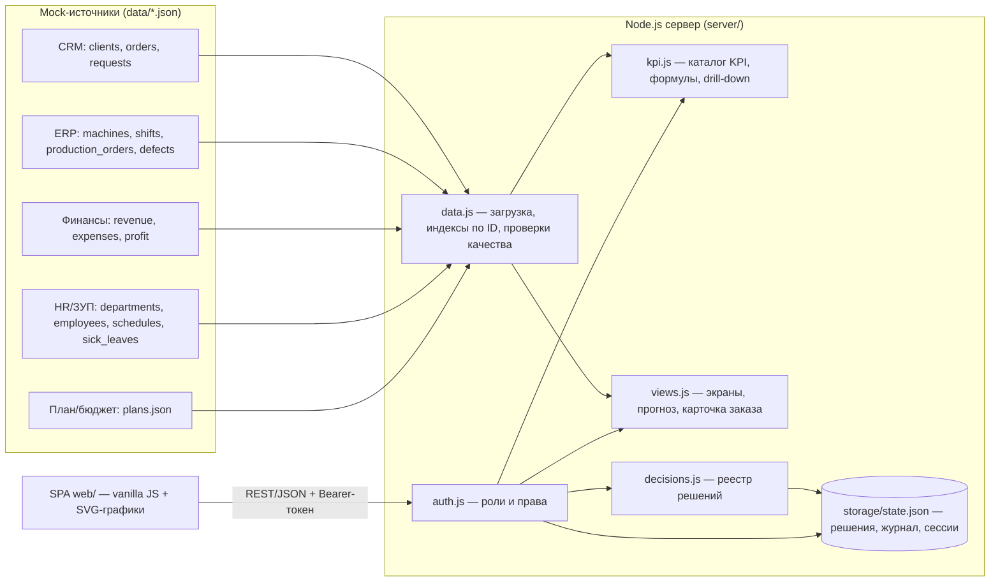

# Пульс компании — единая система управления ООО «Фотопринт»

MVP хакатона «Фабрика идей», **Трек 1 — управленческая платформа**.
Директор видит состояние компании в одном окне, проваливается от красного KPI до станка/заказа/причины
и сразу оформляет управленческое решение, которое сохраняется в реестре и журнале.

> Все данные синтетические и обезличенные. Реальные CRM, ERP и 1С не подключаются — используются
> mock-источники (JSON-файлы), согласованные между собой по ID.

## Демо-стенд

**https://fotoprint-pulse.vercel.app** — открывается в браузере, логины ниже.

## Быстрый старт (≈ 2 минуты)

Нужен только **Node.js ≥ 18** (без `npm install`: внешних зависимостей нет).

```bash
git clone https://github.com/DemProgr/fotoprinthackaton.git
cd fotoprinthackaton
npm start            # или: node server/index.js
```

Откройте **http://localhost:3000**. Порт меняется переменной `PORT=8080 npm start`.

Автотесты критериев приёмки: `npm test`.

### Тестовые учётные записи

**Директор vs аналитик.** Директор управляет: создаёт и ведёт решения, видит все показатели, журнал, качество данных и планы (только чтение).
Аналитик отвечает за данные и методику: решений не принимает, но меняет планы/нормативы KPI (от них зависят статусы),
ведёт разбор проблем качества данных, сравнивает периоды, выгружает записи и журнал в CSV, перезагружает данные.

| Роль | Логин | Пароль | Что видит |
|---|---|---|---|
| Директор | `director` | `director2026` | Все KPI и экраны, создаёт решения, журнал |
| Руководитель производства | `prod` | `prod2026` | Только «Производство и качество», прогноз мощности, свои решения |
| Руководитель продаж | `sales` | `sales2026` | Только «Продажи и клиенты», свои решения |
| Аналитик / администратор | `analyst` | `analyst2026` | Все KPI без права принимать решения; ведёт планы и нормативы KPI, разбирает проблемы качества данных, сравнивает периоды, выгружает CSV, перезагружает данные |

На экране входа есть кнопки быстрого заполнения этих учётных записей.

### Переменные окружения (все необязательные)

| Переменная | По умолчанию | Назначение |
|---|---|---|
| `PORT` | `3000` | Порт HTTP-сервера |
| `HOST` | `0.0.0.0` | Интерфейс |
| `DATA_DIR` | `./data` | Каталог с JSON-источниками |
| `STORAGE_DIR` | `./storage` | Где хранятся решения, журнал и сессии без БД (`state.json`, создаётся автоматически, в git не попадает) |
| `SUPABASE_URL`, `SUPABASE_SERVICE_ROLE_KEY` | — | **База данных Supabase (PostgreSQL)** — данные CRM/ERP/Финансов/HR, решения, журнал, планы |
| `SESSION_SECRET` | генерируется и хранится в БД | Ключ подписи токенов сессий (на Vercel обязательно задать в настройках проекта) |
| `KV_REST_API_URL`, `KV_REST_API_TOKEN` | — | Альтернатива: Redis (Upstash / Vercel KV) только для решений и журнала |

Локально переменные читаются из `.env.local` (`npm start`).

### База данных Supabase

Все ID связаны внешними ключами: заказ CRM → производственный заказ ERP → смена → оператор HR → подразделение;
оплата → заказ и клиент; решение → пользователь. Схема — в `supabase/`.

1. SQL Editor → выполнить `supabase/schema.sql` (таблицы, RLS, пользователи системы).
2. `npm run db:seed` — залить данные из `data/*.json` (нужны `SUPABASE_URL` и `SUPABASE_SERVICE_ROLE_KEY` в `.env.local`).
3. SQL Editor → выполнить `supabase/constraints.sql` (внешние ключи; запрос в конце показывает «битые» ссылки исходных выгрузок).

Ключ `service_role` используется только сервером; RLS включён на всех таблицах без политик, так что из браузера БД недоступна.
Если Supabase недоступен, сервер продолжает работать на файлах `data/*.json`.

### Развёртывание на Vercel

`vercel.json` раздаёт `web/` как статику, а `/api/*` — через бессерверную функцию `api/index.js`.
Команда: `npx vercel deploy --prod`. В Settings → Environment Variables задайте `SUPABASE_URL`,
`SUPABASE_SERVICE_ROLE_KEY` и `SESSION_SECRET` — без БД хранилище на Vercel — временная папка экземпляра функции,
и созданные решения пропадают через несколько минут.

Секретов и ключей в репозитории нет: пароли хранятся только как scrypt-хэши, токены сессий генерируются случайно.

## Что реализовано

| Требование ТЗ | Где в системе |
|---|---|
| **Пульс компании**: план, факт, прогноз и цветовой статус KPI; фильтры периода / подразделения / продукта | `#/pulse` — 17 KPI, все графики пересчитываются при смене фильтра |
| **Кнопка «i»** у каждого KPI: формула, источник, время обновления | всплывающая карточка на каждом KPI |
| **Drill-down**: от агрегата к подразделению, станку, продукту, заказу, причине | клик по KPI → разрезы → записи → сквозная карточка заказа (CRM → ERP → смена/оператор HR → оплаты) |
| **Карточка решения**: проблема, влияние, причина, действие, владелец, срок, приоритет, статус | кнопка «Создать решение» в детализации — поля заполняются из контекста отклонения |
| **Реестр решений**: фильтры, статус, история изменений | `#/decisions` |
| **Прогноз спроса и мощности ≥ 4 недель**, неделя дефицита | `#/forecast` (8 недель, учёт плановых ремонтов и больничных) |
| **Кабинет аналитика**: свежесть, пропуски/дубли, сверка финансов, разбор проблем со статусами | `#/analyst` |
| **Планы и нормативы** (аналитик меняет с обоснованием, директор видит) | `#/plans` |
| **Сравнение периодов** по всем KPI (к прошлому периоду / году) | `#/compare` |
| **Журнал действий** (кто, когда, что, объект, результат) | `#/audit` |
| Экраны «Продажи и клиенты», «Производство и качество», «Финансы и люди» | воронка, конверсия, ср. чек, повторные/отток, каналы и сегменты; план/факт выпуска, очередь, загрузка, простои, брак; БДР/БДДС план-факт, штат/факт, вакансии, отсутствие |

### KPI (17, все рассчитываются из данных)

Финансы: оборот, валовая маржа, расходы план/факт · Продажи: заказы, средний чек, конверсия воронки,
новые клиенты, активные клиенты, повторные покупки, SLA поддержки · Производство: выпуск план/факт,
заказы в срок, брак/перепечатка, lead time, загрузка мощности · Персонал: обеспеченность персоналом,
отсутствующие (больничные). Критические отклонения считаются автоматически.

Цвет статуса: **зелёный** ≥ 98% плана, **жёлтый** ≥ 90%, **красный** < 90% (для показателей «чем меньше — тем
лучше» — обратное отношение). Прогноз — линейный тренд по недельным/месячным точкам периода.
Формулы всех KPI — в [`server/kpi.js`](server/kpi.js) и во всплывающей карточке «i».

### Надёжность и ошибки (ОТ-05)

- Пропала сеть или сервер → баннер «Нет связи с сервером», индикатор в шапке, автопроверка связи каждые 5 с, кнопка «Повторить». Интерфейс не зависает (таймаут запроса 10 с).
- Форма решения автоматически сохраняет черновик в браузере: при обрыве связи введённое не теряется; при закрытии с несохранёнными изменениями — предупреждение.
- Неверные данные формы → ошибки на русском у каждого поля (проверка на сервере — источник истины).
- Битый JSON-источник при перезагрузке данных → понятная ошибка, система продолжает работать на предыдущей версии данных.
- Нет прав → 403 с сообщением «закрыто для вашей роли», попытка фиксируется в журнале.

## Архитектура

Подробно — [docs/architecture.md](docs/architecture.md), API — [docs/api.md](docs/api.md).



Стек: Node.js (встроенные `http`, `crypto`, `fs`), HTML/CSS/JS без сборки. Графики — собственный SVG-модуль,
поэтому интерфейс работает без интернета (нет CDN и внешних шрифтов).

## Структура репозитория

```
server/            сервер и бизнес-логика (index.js — маршруты API)
web/               клиентское SPA (index.html, app.js, charts.js, app.css)
data/              синтетические источники: crm/, erp/, finance/, hr/, plans.json, mock.db
tests/             автотесты критериев приёмки (node:test)
docs/              архитектура, API, отчёт о тестировании, сценарий демо
prototype/         первый статичный макет дашборда (по public/photo_*.jpg)
generate.py        генератор синтетических данных (seed=42)
tools/localize-by.js   перевод данных в белорусский контекст: BYN, города РБ, телефоны +375
validate.py        проверка внешних ключей
build_db.py, schema.sql   сборка SQLite-версии данных
```

## Данные

| Источник | Таблицы | Строк |
|---|---|---|
| CRM | clients / orders / requests | 120 / 620 / 210 |
| ERP | machines / shifts / production_orders / defects | 18 / 150 / 432 / 98 |
| Финансы | revenue / expenses / profit | 471 / 95 / 22 |
| HR / ЗУП | departments / employees / schedules / sick_leaves | 9 / 72 / 521 / 34 |
| План/бюджет | plans.json — месячные планы, нормативы, мощность, плановые ремонты, штатное расписание | — |

Ключевые связи: `orders.client_id → clients.id`, `production_orders.order_id → orders.id`,
`production_orders.machine_id → machines.id`, `production_orders.shift_id → shifts.id`,
`shifts.operator_id → employees.id`, `defects.production_order_id → production_orders.id`,
`revenue.order_id → orders.id`, `requests.order_id → orders.id`, `employees.department_id → departments.id`.

**Повторная загрузка данных**: отредактируйте/замените JSON в `data/` (или перегенерируйте: `python generate.py && node tools/localize-by.js` —
второй шаг переводит суммы в BYN, города клиентов в города Беларуси, телефоны в формат +375 и пересобирает `mock.db`)
и нажмите «Перезагрузить данные» в кабинете аналитика — либо перезапустите сервер.

В данные специально заложены проблемы для демонстрации кабинета аналитика: разорванные связи (ID 999999/999998),
брак больше выпуска, смена во время больничного, отгруженные заказы без оплаты, дубли платежей,
расхождение месячной отчётности с платежами за 2025-08 (1 800 BYN).

Допущения (данные синтетические): «сегодня» для расчётов — последний день месяца последней транзакции (31.10.2026);
время хранится с часовым поясом UTC+3 (Минск); валюта — белорусский рубль (BYN): суммы базового набора масштабированы коэффициентом 28 (условный, не биржевой курс), клиенты — из городов Беларуси;
lead time считается по производственным датам ERP (end_date − start_date).

## Известные ограничения

- Без настроенного Supabase хранилище — JSON-файл; с Supabase всё хранится в PostgreSQL.
- Источники — файлы, а не живые интеграции; слой `server/data.js` изолирует их, адаптеры к CRM/ERP/1С заменят чтение файлов.
- Ответственный в решении — свободный текст (в пилоте — выбор из справочника сотрудников HR).
- Сессии хранятся на сервере 12 ч; нет восстановления пароля и SSO.

## Документы для сдачи

- [docs/architecture.md](docs/architecture.md) — архитектура и потоки данных
- [docs/api.md](docs/api.md) — описание REST API
- [docs/test-report.md](docs/test-report.md) — отчёт о тестировании по критериям УП-01…УП-05
- [docs/demo-script.md](docs/demo-script.md) — сценарий демонстрации на 5–7 минут

## Лицензии (ОТ-08)

Внешних библиотек, моделей и заимствованных компонентов нет: сервер использует только стандартную библиотеку Node.js
(MIT), клиент — собственный код. Шрифт — системный (Segoe UI / Inter, если установлен). Данные сгенерированы
командой (`generate.py` + `tools/localize-by.js`), реальных людей, компаний и контактов в них нет, лицензия проекта — MIT.
