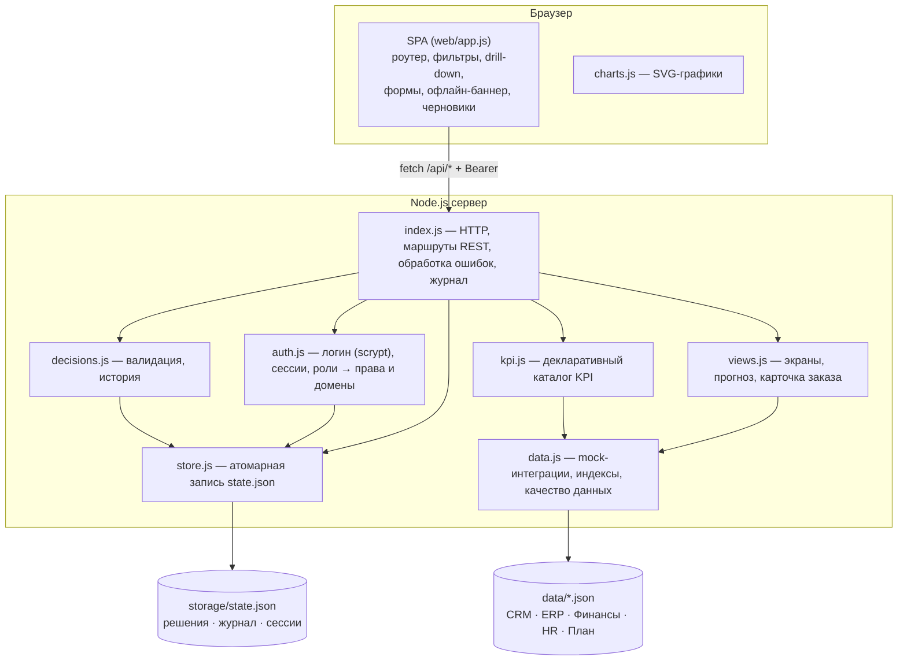
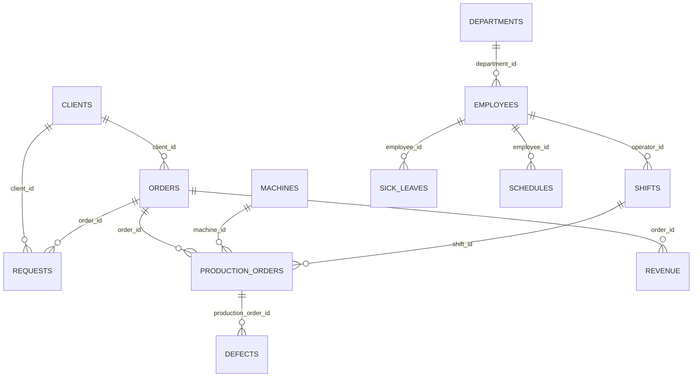

# Архитектура и потоки данных

## Компоненты



## Поток «от агрегата к причине»

```mermaid
sequenceDiagram
  actor Dir as Директор
  participant UI as SPA
  participant API as Сервер
  Dir->>UI: Открывает «Пульс компании», выбирает период/продукт
  UI->>API: GET /api/kpi?period=90d&product=…
  API-->>UI: 17 KPI (факт, план, прогноз, статус, ряд, формула, источник)
  Dir->>UI: Клик по красному KPI «Брак»
  UI->>API: GET /api/kpi/defect/drill?dim=machine
  API-->>UI: группы по станкам + объяснение «главный вклад: Станок №14»
  Dir->>UI: Клик по станку → записи → заказ
  UI->>API: GET /api/kpi/defect/records?dim=machine&key=…, GET /api/orders/:id
  API-->>UI: производственные заказы; карточка CRM→ERP→HR→Финансы
  Dir->>UI: «Создать решение» (поля предзаполнены контекстом)
  UI->>API: POST /api/decisions
  API->>API: валидация, проверка домена, запись state.json, журнал
  API-->>UI: РЕШ-0001 — видно в реестре после повторного входа
```

## Модель данных и связи



Решения (`decision`) хранят `kpi_id`, `domain` и `context` (фильтры, разрез и ключ детализации),
поэтому каждое решение трассируется до отклонения, из которого создано.

## Безопасность

- Права проверяются **на сервере** в каждом маршруте: `requirePerm` (действие) и `requireDomain` (подразделение).
- Руководитель видит только KPI, разрезы, записи, экраны и решения своего домена; в сквозной карточке заказа
  чужие данные маскируются (суммы оплат для производства, детали смен для продаж).
- Пароли — scrypt + соль, сравнение `timingSafeEqual`; токен сессии — 192 бита случайности, TTL 12 ч.
- Вход/выход, просмотры, детализации, создание/изменение решений, отказы в доступе и перезагрузка данных пишутся в журнал.
- Защита от XSS: весь пользовательский текст экранируется на клиенте; лимит тела запроса 64 КБ; защита от path traversal в статике.

## Переход к пилоту

1. `store.js` → PostgreSQL (таблицы `decision`, `decision_history`, `audit_log`, `session`).
2. `data.js` → адаптеры к CRM/ERP/1С по расписанию (ETL в витрину), метки свежести уже поддерживаются.
3. SSO (AD/Keycloak) вместо локальных учётных записей; роли и домены — из справочника HR.
4. Уведомления ответственным по решениям (почта/мессенджер), эскалация просроченных.
